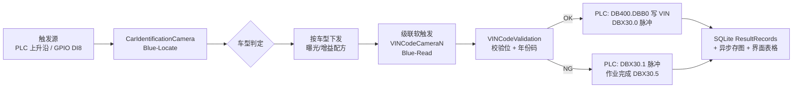

# SmartVisionSystem —— 冲压机身 VIN 码打刻识别系统

面向汽车制造冲压 / 焊装车间的多工位工业视觉系统。以 Cognex ViDi 深度学习完成车型定位与 VIN 码 OCR 读码，识别结果同时下发 PLC、写入 SQLite 记录库并在界面实时展示。

- 运行平台：Windows x64 / .NET Framework 4.8 / WinForms（SunnyUI 皮肤）
- 解决方案：`SmartVisionSystem.sln`，程序集版本 `1.0.0.0`
- 本仓库收录 87 个文件（源代码 + 工程文件 + 核心配置文件）

## 一、系统做什么

产线上，17 位 VIN 码以钢印打刻在车身板件上。本系统的职责是：**判定当前板件属于哪个车型、是否需要返修，读出钢印 VIN 码，校验其正确性，并把结论交给 PLC 决定放行或拦截**。

识别分为两级，由不同相机分工：

| 层级 | 相机 | ViDi 工具 | 任务 |
| --- | --- | --- | --- |
| 第一级 | `CarIdentificationCamera` | **Blue-Locate**（`Tools["Locate"]`） | 识别车型（`A09 / T58 / A39 / T68 / A66 / V22 / V22-G` 等）并判定是否为返修车 |
| 第二级 | `VINCodeCamera1` ~ `VINCodeCamera8` | **Blue-Read**（`Tools["Read"]`） | 读取钢印 VIN 码并做字符级校验 |

第二级不是全部执行，而是由第一级的车型结果**级联触发**：车型相机先出结果，再按车型选定对应的读码相机、并把该车型的曝光 / 增益配方下发过去。读码失败时按预设链路切换到备用工位（如 `A09 → Cam2`、`T58 → Cam4`、`T68/A66 → Cam3`、`V22 → Cam6`）。

> 注意：`CarIdentificationCamera` 识别的是**车型**，不是车标 Logo。

### 处理流程



## 二、VIN 码校验规则

校验在 `VisionCore/VINCodeValidation.cs` 中实现。OCR 结果先剔除未识别占位符 `*` 与 `?`，再按有效长度分流：

**17 位标准 VIN —— ISO 3779 加权校验**

字符映射时排除 `I / O / Q`；位置权重序列为 `8,7,6,5,4,3,2,10,0,9,8,7,6,5,4,3,2`；第 9 位为校验位、不参与加权和；加权和 `% 11` 与第 9 位比对，校验位为字母时按 `10 = X` 处理。校验位通过后**还要再看年份码**：第 11 位（索引 10）必须落在 30 年循环表 `123456789ABCDEFGHJKLMNPRSTVWXY`（同样排除 `I/O/Q/U/Z`）的当前年前 4 年至后 2 年区间内。

**7 位短码 —— mod-11 校验**

第 1 位为校验位，后 6 位分别乘以 7~2 求和后取模 11，余数为 10 时校验位须为 `X`。

其余长度直接判 NG。代码中没有独立的字符白名单正则，合法性由上述算法与 ViDi Read 模型共同保证。

## 三、目录结构

```
.
├─ SmartVisionSystem.sln
├─ HslCommunication/                 # 本地引用的第三方通讯库（非 NuGet，必须入库）
│   ├─ HslCommunication.dll / .xml
│   └─ Newtonsoft.Json.dll / .xml
└─ SmartVisionSystem/
    ├─ Program.cs                    # 入口：单实例 Mutex + 闪屏 + log4net 注册
    ├─ SmartVisionSystem.csproj      # 目标框架 v4.8，x64 平台
    ├─ App.config                    # EF6 / SQLite Provider 注册
    ├─ packages.config               # NuGet 依赖清单
    ├─ UIForm/
    │   ├─ MainForm.cs               # 主窗体：全部硬件与配置的装配点
    │   ├─ Pages/                    # FormLogin / FormCamera / FormSystemSet / CameraSet
    │   ├─ Canvas/                   # ImageViDiDisplay / ImageDisplay / FormLog
    │   └─ SplashScreenForm.cs       # 启动进度闪屏
    ├─ VisionCore/
    │   ├─ CameraBase.cs             # 相机抽象基类（句柄、图像队列、配方、权限实体）
    │   ├─ MVCamera.cs               # 海康 MvCamCtrl.NET SDK 封装
    │   ├─ CarIdentificationCamera.cs# 车型 / 返修识别（Blue-Locate）
    │   ├─ VINCodeCamera1..8.cs      # 8 路读码工位（Blue-Read）+ 级联逻辑
    │   ├─ VisionTools.cs            # .vrws 工作区加载与 ViDi2 运行时桥接
    │   ├─ VINCodeValidation.cs      # VIN 校验算法
    │   ├─ VINCodeResult.cs          # 结果实体
    │   ├─ SystemConfigurations.cs   # 配置实体（PLC / 串口 / 地址表 / 相机参数）
    │   ├─ ImageSaveQueue.cs         # 异步存图队列
    │   ├─ SQLiteHelper.cs / ClsLock.cs  # 数据落库与读写锁
    │   └─ CSTControllerAPI.cs / RseeControllerAPI.cs / TOP-GPIO-1808.cs
    ├─ Log4Net/                      # 日志 Appender 与级别封装
    ├─ Properties/                   # AssemblyInfo、资源
    └─ bin/x64/Configurations/       # ★ 核心必需配置，见下节
        ├─ CameraConfigurations.json # 系统总配置（窗体关闭时也会把运行期修改写回此处）
        ├─ UserData.txt              # 登录账号（XOR 加密落盘）
        └─ 备份/                     # 系统设置页保存时，旧 JSON 按时间戳移入此目录
```

## 四、技术栈与依赖

| 类别 | 组件 | 版本 / 说明 |
| --- | --- | --- |
| 框架 | .NET Framework | 4.8，`PlatformTarget = x64` |
| UI | WinForms + SunnyUI / SunnyUI.Common | 3.4.0（主窗体为 `UIHeaderAsideMainFrame`） |
| 视觉 | Cognex VisionPro | 73.0.0.0（图像容器 `ICogImage`、存图 `CogImageFileBMP`） |
| 深度学习 | VisionPro Deep Learning（ViDi2） | 2.1，`ViDi.NET.*`；运行时 `ViDi2.Runtime.Local.Control(GpuMode.SingleDevicePerTool)` |
| 相机 SDK | 海康威视 MvCamCtrl.NET | GigE / USB3 工业相机，按序列号匹配工位 |
| PLC 通讯 | HslCommunication | **`SiemensS7Net(SiemensPLCS.S1500)`** |
| 数据库 | System.Data.SQLite + EntityFramework | SQLite 1.0.118.0，EF 6.4.4 |
| 日志 | log4net | 2.0.15，文件 + 界面双通道 |

> 变量命名提示：PLC 客户端变量沿用历史名 `MyMelsecMcNet`，但实际类型是西门子 S7（`MainForm.cs` 中 `new SiemensS7Net(SiemensPLCS.S1500)`，配置里的 `DB400.*` 地址正是西门子数据块写法）。三菱 MC 相关代码已注释保留。

## 五、编译环境要求

1. Visual Studio 2022（含 .NET Framework 4.8 目标包），Windows x64。
2. 已安装 **Cognex VisionPro 73** 与 **VisionPro Deep Learning 2.1**。`ViDi.NET.*` 的 `HintPath` 写死为
   `C:\Program Files\Cognex\VisionPro Deep Learning\2.1\Cognex Deep Learning Studio\`，若安装路径不同需改 `.csproj` 或装到同一路径。
3. 已安装海康威视 MVS 客户端运行库（提供 `MvCameraControl.dll`）。
4. 还原 NuGet 依赖（`packages/` 不入库，克隆后需还原）：
   ```powershell
   nuget restore SmartVisionSystem.sln
   ```
5. **平台配置必须选 x64**，AnyCPU 下 `Prefer32Bit` 会因加载 64 位原生库（海康 SDK、`BMI.dll`、VisionPro / ViDi）失败。
6. `HslCommunication/` 是本地 DLL 引用而非 NuGet 包，已随仓库提供，克隆后无需额外处理。

## 六、核心必需配置：`bin/x64/Configurations`

程序所有运行时资源路径都由 `Path.GetFullPath("..")` 解析（可执行文件位于 `bin\x64\Debug` 或 `bin\x64\Release`，`..` 即回到 `bin\x64\`）。因此本目录**必须存在于运行目录的上一级**，且：

- 缺 `CameraConfigurations.json` → `MainForm` 构造函数中 `Json.DeserializeFromFile` 直接抛异常，**启动即崩溃**（该处无 try 包裹）。
- JSON 中缺少某台相机的条目 → `ListCameraParameters.Find(...)` 返回 null，访问 `.CameraExposure` 触发空引用。

`CameraConfigurations.json` 主要字段：

| 字段 | 含义 |
| --- | --- |
| `PLCCommunicationIP` / `PLCCommunicationPort` | S7-1500 地址与端口（现场为 `192.168.1.1` / `102`），连接与接收超时各 1 s |
| `SystemOnlineAddress` | 心跳地址，`HearBeattimer` 每 1 s 写方波 |
| `AutoModelAddress` | 自动 / 手动模式位，300 ms 轮询并同步给所有相机 `IsAutoStatus` |
| `CameraTriggerAddress` | 触发上升沿（0→1 软触发车型相机，采图后回写 False 复位） |
| `CarModelCameraCarModelAddress` | 车型字符串写入地址 |
| `VINCodeCameraVINCodeAddress` | VIN 字符串写入地址 |
| `VINCodeCameraOKAddress` / `NGAddress` / `JobRunDoneAddress` | OK / NG / 作业完成脉冲，写法统一为 `True → Sleep(300 ms) → False` |
| 光源串口配置 | `COM1` / `COM2`，19200 / N / 8 / 1 |
| `ListCameraParameters` | 每台相机的序列号、曝光、增益、触发模式、是否存 OK / NG 图、备注（车型归属） |

只有「自动模式 + PLC 已连接」时才写 PLC，手动模式不写。

光源控制实际使用**串口文本协议**（`SA0255#` 开、`SA0000#` 关，通道 `SA / SB / SC` 对应车型 + 4 位亮度）。`CSTControllerAPI.cs`、`RseeControllerAPI.cs` 是 CST / Rsee 光源控制器 DLL 的 P/Invoke 封装，**当前工程预留未调用**。

触发源有两路并行：PLC `DBX30.6` 上升沿，以及 **TOP-GPIO-1808 数字 IO 板卡**（`BMI.dll`，`DO1~8 = Pin0~7 / DI1~8 = Pin8~15`）DI 引脚 8 的低电平沿。

## 七、登录与权限

账号存储在 `Configurations/UserData.txt`，每行 `用户名,密码,权限值`，以固定密钥 `"123456"` 做 XOR 加密落盘（加解密密钥见 `FormLogin.cs`）。

| 权限值 | 角色 | 可用能力 |
| --- | --- | --- |
| `0` | 技术员（默认） | 只读监控 |
| `2` | 二级 | —— |
| `5` | 三级 / 管理员 | 用户管理（代码判定为 `Authority > 2`） |

`Authority >= 1` 才允许手动拍照与本地图片离线回放（`ImageViDiDisplay.cs`）。另有独立门槛：**系统设置页参数分组的编辑权按账号名 `== "超级管理员"` 判断**，与数值权限并存。键鼠空闲超过 3 分钟（`GetLastInputInfo`）会自动把当前权限降级回技术员。

## 八、结果落库与存图

- **SQLite**：`bin/x64/VINDataRecord/DataRecord.db`，不存在则自动创建。表 `ResultRecords`，字段 `RecordTime, CameraName, CarModel, VINCode, Result`（`FX` 返修特征仅在界面结果队列展示，未落库）。写入走 `ExecuteSqlTran` 事务批量提交，并用 `ClsLock` 按库文件持读写锁避免 `database is locked`。
- **存图**：`ImageSaveQueue` 为全局异步队列（默认容量 32），相机线程入队即返回，后台线程按扩展名落盘。目录结构
  `..\Images\{yyyy-MM-dd}\{相机名}\{OK|NG}\{车型}\{HH-mm-ss}[-_VIN/FX][_NG].bmp`，
  受各相机 `IsSaveOKImage` / `IsSaveNGImage` 开关控制，队列满时**直接丢帧**。`CameraBase.CheckAndDelete()` 在所在盘剩余空间低于 50 GB 时删除日期最早的一天目录。

## 九、不随本仓库分发的资产（重要）

`.gitignore` 出于体积与保密原因继续排除以下内容，**克隆后仓库不足以直接跑起来**：

| 内容 | 原始大小 | 排除原因 |
| --- | --- | --- |
| `bin/x64/CameraVisionTool/**/*.vrws` | 724 MB | VisionPro / ViDi 工作区（内含按车型划分的模型流），**单文件最大 245 MB，超过 GitHub 100 MB 硬限制** |
| `bin/x64/Debug/` | 2.0 GB | CUDA / cuDNN / 海康等原生运行时 DLL |
| `bin/x64/VINDataRecord/` | 1.3 MB | 产线真实识别记录 |
| `packages/` | 100 MB | NuGet 包，用 `nuget restore` 还原 |
| `.vs/`、`obj/`、`log/`、`*.dll`、`*.pdb` | —— | 构建产物与日志 |

缺少 `.vrws` 的后果（`VisionTools.ToolsInitialization`）：工作区目录不存在 → `DirectoryNotFoundException` 未捕获，启动崩溃；目录存在但为空 → 记日志后 `Environment.Exit` 退出；单个 `.vrws` 加载异常 → 同样 `Environment.Exit`。**ViDi 加载失败是硬退出，不会静默空跑。**

需要分发 `.vrws` 时建议改用 Git LFS 或内网文件服务器，并在 `CameraVisionTool/{相机名}/` 下按相机名组织；`VINCodeCamera7/8` 为预留工位，目录内仅占位文件即可正常启动。

## 十、投产前必须处理的事项

1. **本仓库内容包含现场实际配置**：`CameraConfigurations.json` 内含真实 PLC 地址、串口分配、DB400 地址表与各相机序列号，`UserData.txt` 内含现场账号口令。若仓库对外可见，请**先替换为本厂网络规划中的占位地址、并重置全部账号口令**，再公开或分享。
2. `UserData.txt` 的 XOR 加密强度极低且密钥明文写在源码中，**不能视为真正的凭据保护**，仅作防误改用途；接入公司域账号或改用加盐哈希是后续应当收紧的方向。
3. `ViDi.NET.*` 的 `HintPath` 与相机序列号绑定了原开发机与现场硬件，换机需同步调整。
4. `UIForm/Pages/VisionToolSet.cs`（VisionPro `CogToolBlockEditV2` 编辑页）为遗留文件，**未被 `.csproj` 编译引用**，现行系统已改用 ViDi。

## 十一、开源与合规提示

本项目为客户产线定制工程，包含第三方商业组件（Cognex VisionPro / VisionPro Deep Learning、海康 MVS、HslCommunication 商业授权）与厂商标识素材。公开源码前请确认已取得相应授权许可。
